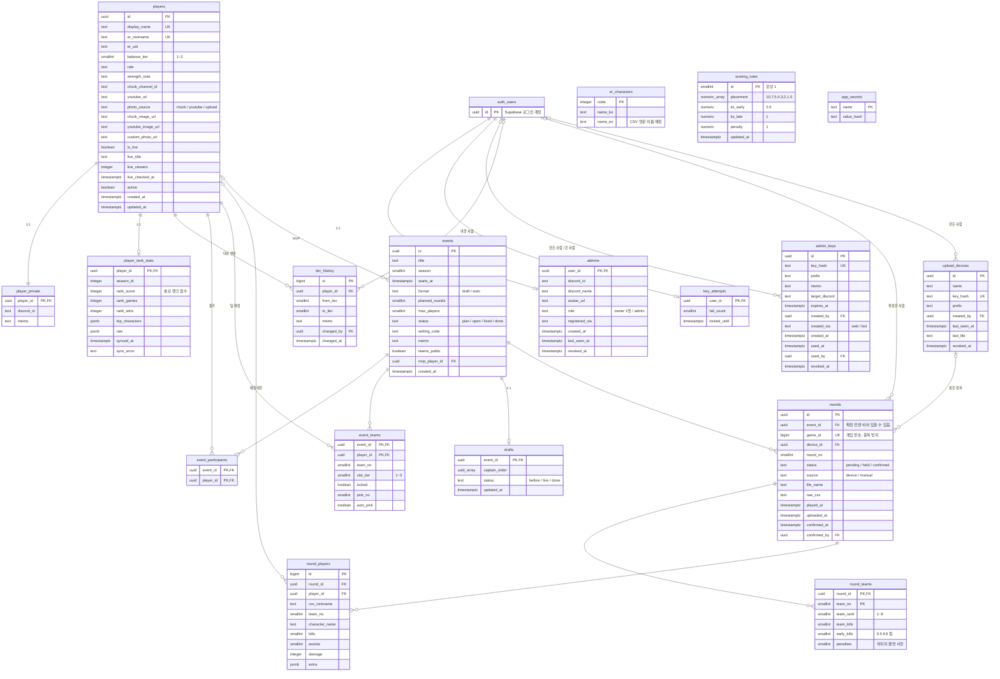

# 무명섬 ERD

설명서 전체는 Claude 문서 "무명섬 설명서 · ERD" 에 있어요. 이 파일은 GitHub 에서 바로 볼 수 있는 관계도예요.
기준: `supabase/migrations/20261027000000_init.sql` + `20261028000000_results.sql`

## 키 없이 값으로 이어지는 것
- `player_rank_stats.top_characters` 의 실험체 번호 → `er_characters.code`
- `round_players (round_id, team_no)` → `round_teams (round_id, team_no)`: 선수 기록에 그 팀 점수를 붙일 때
- `scoring_rules` (1줄) × `round_teams` → 점수 계산 뷰

## 계산 뷰 (확정된 라운드만)
| 뷰 | 내용 |
| --- | --- |
| `v_round_team_scores` | 라운드 × 팀별 RS · KS · 감점 · 합계 |
| `v_event_standings` | 내전 × 팀별 누적 점수와 순위 (합계 → KS 순) |
| `v_player_rounds` | 선수 × 라운드 기록 + 그 팀 점수 |
| `v_player_stats` | 선수 × 시즌 평균 (전체 + 최근 30일) |
